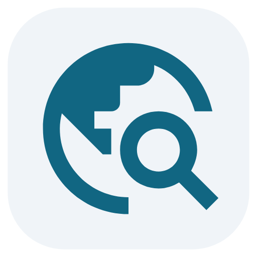
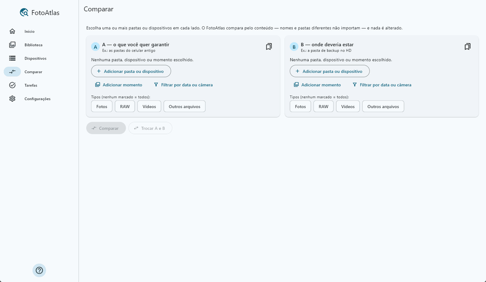
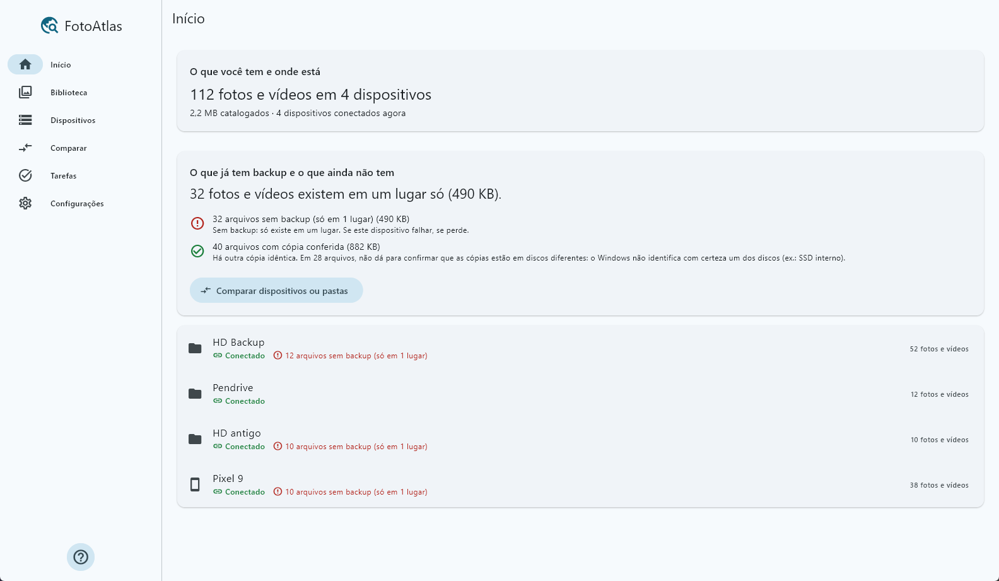
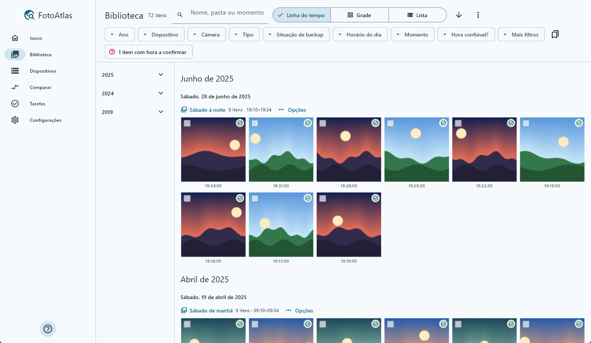
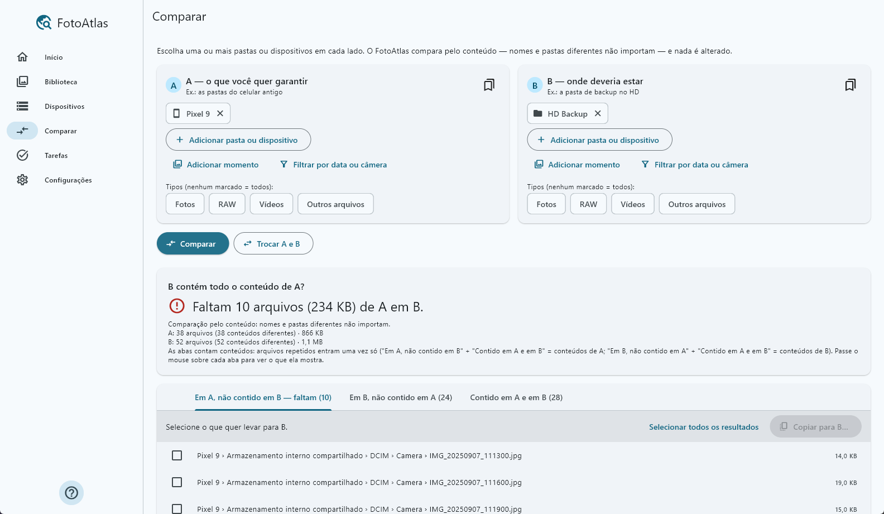
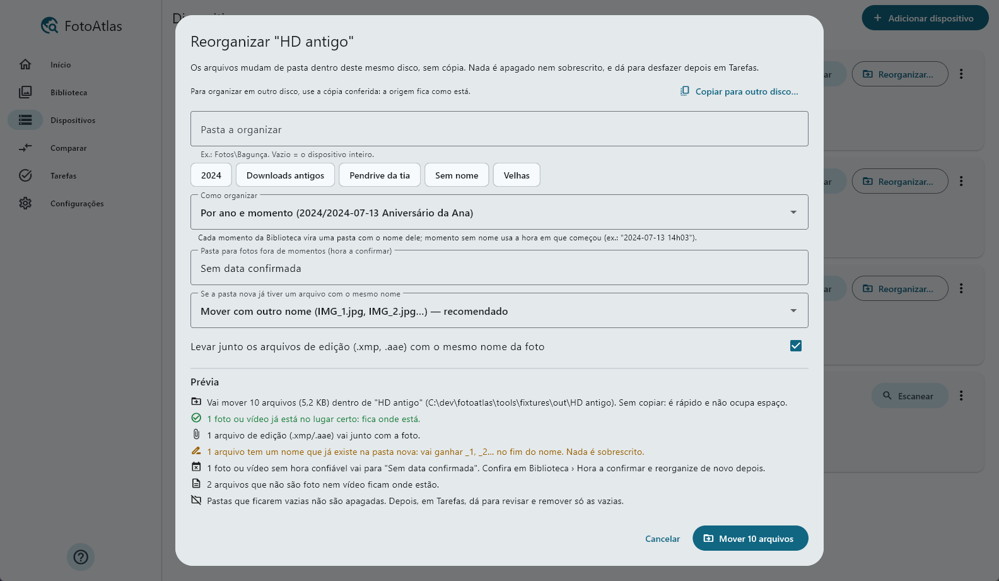
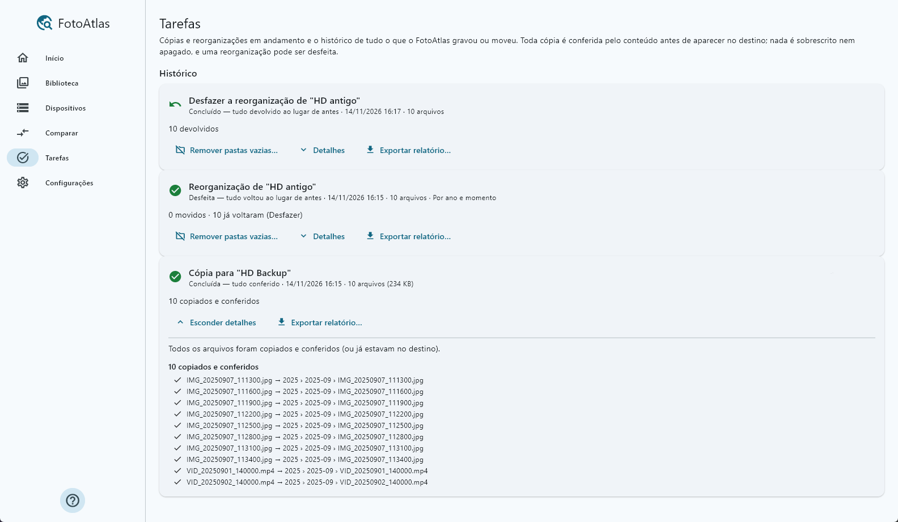
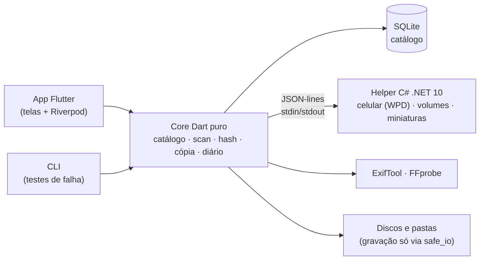



# FotoAtlas

## ⬇️ Baixar

  

1. Clique no botão acima e, em **Assets**, baixe o arquivo **`FotoAtlas-<versão>-instalador.exe`**.
2. Abra o arquivo baixado e clique em **Instalar**.
3. Se aparecer **"O Windows protegeu o computador"**, clique em **Mais informações › Executar assim mesmo** (o instalador ainda não tem assinatura digital).

> ⚠️ **Não baixe "Source code (zip)" nem "Source code (tar.gz)"**: isso é o código-fonte para programadores, não o programa. O que você quer é o arquivo terminado em **`-instalador.exe`**.

Funciona no Windows 10 (versão 1809 ou mais nova) e no Windows 11, 64 bits.

---

Organizador de fotos e vídeos para Windows: descobre o que você tem em cada celular, HD e pendrive, mostra **o que já tem backup e o que ainda falta**, e copia e reorganiza tudo **sem perder nenhum arquivo**, mesmo se a energia cair no meio.

## Telas

> Capturas geradas com dados sintéticos do modo demonstração (nenhuma foto real).

| Início | Biblioteca |
|---|---|
|  |  |
| **Comparar** | **Reorganizar** |
|  |  |
| **Tarefas** | |
|  | |

## Instalar e atualizar

Não é preciso ser administrador nem instalar mais nada: o ExifTool e o FFmpeg já vêm junto. Na instalação, você pode escolher se quer um atalho na área de trabalho. Para atualizar, feche o FotoAtlas e instale a versão nova por cima: o catálogo e as configurações continuam como estavam. Mais detalhes em [Instalar, atualizar e desinstalar](docs/instalacao.md).

## Por que existe

Backups espalhados, pastas organizadas de jeitos diferentes, fotos do celular copiadas só em parte. Copiar tudo de novo "por garantia" só cria mais duplicatas. O FotoAtlas responde:

1. O que eu tenho e onde está?
2. O que já tem backup e o que ainda não tem?
3. O que eu quero levar para onde?
4. Como deixo tudo organizado sem perder nada?

## Princípios

- Analisar nunca modifica seus arquivos.
- Nada é apagado ou sobrescrito automaticamente.
- Toda cópia é conferida byte a byte (SHA-256) e recuperável após interrupções.
- Funciona offline; nenhuma foto ou localização sai do seu computador. (A única consulta à internet é o aviso de versão nova, uma vez por dia e desligável.)

## Destaques técnicos

- **Flutter + Dart + SQLite + helper C#**: UI Flutter fina; toda a regra de negócio num core em Dart puro (com CLI própria); catálogo SQLite (drift) com um único escritor; helper C# .NET 10 em processo separado para celular (WPD, só leitura), volumes e miniaturas, falando JSON-lines.
- **Cópia segura com diário e recuperação**: cada arquivo é gravado num `.part`, conferido por SHA-256 na origem e no destino e só então publicado com `MoveFileExW` sem substituir. Cada passo fica num diário persistente; a recuperação é idempotente e roda ao abrir o app.
- **Testes de falha matando o processo**: a CLI compilada é morta (`TerminateProcess`) em pontos instrumentados da cópia e da própria recuperação; o teste confere diário e disco, roda a recuperação 3 vezes e termina a cópia sem perder nem sobrescrever nada.
- **CI com 4 jobs** no GitHub Actions (Windows): helper .NET, core Dart (inclui testes em VHD FAT32/NTFS e de desempenho com 50 e 100 mil arquivos), app Flutter e instalador (instalar, atualizar e desinstalar de verdade).
- **382 testes automatizados** em todas as camadas: 234 no core e 8 nos fixtures (`dart test`), 84 no app (`flutter test`) e 56 no helper (`dotnet test`).

## Arquitetura

Detalhes em [Arquitetura](docs/arquitetura.md).

## Tecnologias

Flutter · Dart · SQLite · C# .NET 10 (APIs do Windows) · ExifTool · FFmpeg

## Documentação

- [Instalar, atualizar e desinstalar](docs/instalacao.md)
- [Especificação](docs/FOTOATLAS_SPEC.md)
- [Roteiro](docs/ROADMAP.md)
- [Desenvolvimento: build, testes e execução](docs/desenvolvimento.md)
- [Arquitetura](docs/arquitetura.md)
- [Schema do catálogo (v1 + mudanças da v2)](docs/schema-v1.md)
- [Protocolo do helper nativo](docs/protocolo-helper.md)
- [Análise da especificação](docs/analise-spec.md)
- [Decisões técnicas (ADRs)](docs/adr/)

## Licença

MIT
