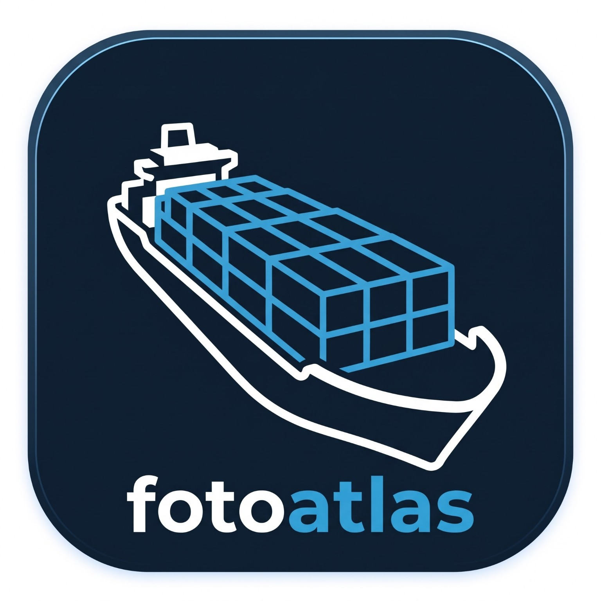

# FotoAtlas

Organizador de fotos e vídeos para Windows: descobre o que você tem em cada celular, HD e pendrive, mostra **o que já tem backup e o que ainda falta**, e copia e reorganiza tudo **sem perder nenhum arquivo**, mesmo se a energia cair no meio.

> 🚧 Em desenvolvimento. Veja o andamento em [`docs/ROADMAP.md`](docs/ROADMAP.md).

## Por que existe

Backups espalhados, pastas organizadas de jeitos diferentes, fotos do celular copiadas só em parte. Copiar tudo de novo "por garantia" só cria mais duplicatas. O FotoAtlas responde:

1. O que eu tenho e onde está?
2. O que já tem backup e o que ainda não tem?
3. O que eu quero levar para onde?
4. Como deixo tudo organizado sem perder nada?

## Princípios

- Analisar nunca modifica seus arquivos.
- Nada é apagado ou sobrescrito automaticamente.
- Toda cópia é conferida byte a byte (SHA-256) e recuperável após interrupções.
- Funciona offline; nenhuma foto ou localização sai do seu computador.

## Tecnologias

Flutter · Dart · SQLite · C# .NET 10 (APIs do Windows) · ExifTool · FFmpeg

## Documentação

- [Especificação](docs/FOTOATLAS_SPEC.md)
- [Roteiro](docs/ROADMAP.md)
- [Desenvolvimento: build, testes e execução](docs/desenvolvimento.md)
- [Arquitetura](docs/arquitetura.md)
- [Schema do catálogo (v1 + mudanças da v2)](docs/schema-v1.md)
- [Protocolo do helper nativo](docs/protocolo-helper.md)
- [Análise da especificação](docs/analise-spec.md)
- [Decisões técnicas (ADRs)](docs/adr/)

## Licença

MIT
